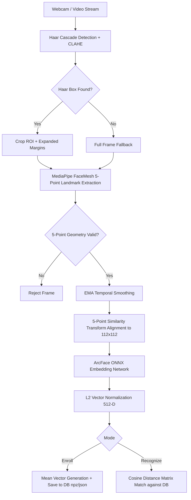

# CPU-Optimized 5-Point ArcFace Face Recognition Pipeline

A high-performance, real-time CPU face recognition system combining **Haar Cascade detection**, **MediaPipe FaceMesh 5-point landmark localization**, **InsightFace ArcFace 5-point similarity transformation alignment**, and **ArcFace ONNX deep feature embeddings**.

---

## Technical Architecture Overview

This project implements an end-to-end, multi-stage face recognition pipeline designed specifically for high accuracy and smooth frame rates on CPU hardware without requiring heavy GPU compute.



### Key Engineering Principles & Optimizations

1. **Hybrid Detection Engine (`Haar5ptDetector`)**:
   - Uses OpenCV Haar Cascades for ultra-fast candidate region proposal on CPU.
   - Applies CLAHE (Contrast Limited Adaptive Histogram Equalization) preprocessing to enhance feature contrast under low-light or backlit environments.
   - Runs MediaPipe `FaceMesh` inside the Haar ROI rather than the full high-res image, dramatically lowering CPU load while retaining sub-pixel landmark precision.
   - Includes full-frame MediaPipe fallback if Haar misses a face.

2. **Geometric Sanity Filtering & EMA Smoothing**:
   - Enforces keypoint spatial constraints (`_kps_span_ok`): eye distance minimum threshold and relative mouth-below-eye positioning to prevent false positives.
   - Applies Exponential Moving Average (EMA) smoothing across successive frames to eliminate bounding box and landmark jitter.

3. **ArcFace Standard 112x112 Similarity Transformation**:
   - Maps 5 key facial points (left eye, right eye, nose tip, left mouth corner, right mouth corner) to standard InsightFace reference coordinates.
   - Uses 2D Partial Affine Transformation (`cv2.estimateAffinePartial2D`) to scale, translate, and rotate the face into strict alignment regardless of head tilt.

4. **Deep Feature Embedding & L2 Vector Space**:
   - Inputs aligned 112x112 BGR image (normalized via `(RGB - 127.5) / 128.0`) into `embedder_arcface.onnx` via ONNX Runtime CPU Provider.
   - Normalizes feature vectors using L2 norm ($\|v\|_2 = 1$). Matching reduces to fast matrix dot product calculation for Cosine Similarity.

---

## Mathematical Formulations

### 1. 5-Point Affine Similarity Alignment
Given detected keypoints $K \in \mathbb{R}^{5 \times 2}$ and target ArcFace template coordinates $T \in \mathbb{R}^{5 \times 2}$:

$$T = \begin{bmatrix} 38.2946 & 51.6963 \\ 73.5318 & 51.5014 \\ 56.0252 & 71.7366 \\ 41.5493 & 92.3655 \\ 70.7299 & 92.2041 \end{bmatrix}$$

The optimal 2x3 affine matrix $M^*$ minimizes transformation error:

$$M^* = \arg\min_{M} \sum_{i=1}^{5} \| M \cdot [K_i, 1]^T - T_i \|^2$$

### 2. L2 Feature Vector Normalization
For raw ONNX output embedding vector $v \in \mathbb{R}^D$:

$$\hat{v} = \frac{v}{\|v\|_2 + \epsilon} = \frac{v}{\sqrt{\sum_{k=1}^D v_k^2} + \epsilon}$$

### 3. Cosine Similarity & Cosine Distance
For two normalized vectors $a, b \in \mathbb{R}^D$ where $\|a\|_2 = \|b\|_2 = 1$:

$$\text{Sim}(a, b) = a \cdot b = \sum_{k=1}^D a_k b_k$$

$$\text{Dist}_{\text{cos}}(a, b) = 1 - \text{Sim}(a, b)$$

### 4. Exponential Moving Average (EMA) Smoothing
To stabilize bounding box coordinates $B_t$ and keypoints $K_t$ with smoothing parameter $\alpha = 0.80$:

$$S_t = \alpha S_{t-1} + (1 - \alpha) X_t$$

---

## Directory Structure

```
face-tracking-with-motor/
├── data/
│   ├── db/
│   │   ├── face_db.npz            # Enrolled vector embeddings (name -> float32 array)
│   │   └── face_db.json           # Identity metadata & timestamp tracking
│   ├── debug_aligned/             # Aligned 112x112 crops saved during alignment debugging
│   └── enroll/                    # Enrolled identity crops (data/enroll/<person_name>/*.jpg)
├── models/
│   └── embedder_arcface.onnx      # ArcFace feature extraction model (13.6 MB)
├── src/
│   ├── __init__.py                # Package initializer
│   ├── camera.py                  # Step 1: Webcam hardware verification script
│   ├── detect.py                  # Step 2: Minimal Haar face detection test
│   ├── landmarks.py               # Step 3: 5-Point MediaPipe FaceMesh test
│   ├── align.py                   # Step 4: 112x112 similarity warp test & debug saving
│   ├── haar_5pt.py                # Core Engine: Haar + MediaPipe 5pt Detector class
│   ├── embed.py                   # Step 5: ArcFace ONNX embedder & heatmap visualization
│   ├── enroll.py                  # Step 6: Interactive identity enrollment CLI/GUI
│   ├── evaluate.py                # Step 7: FAR/FRR threshold sweep tuning suite
│   └── recognize.py               # Step 8: Production live multi-face recognition
├── init_project.py                # Initial directory generator utility
└── README.md                      # Project documentation
```

---

## Module Breakdown (`src/`)

| Module | Primary Class / Function | Purpose |
| :--- | :--- | :--- |
| **`src.camera`** | `main()` | Opens webcam stream (`index=0`) to verify capture functionality and frame resolution. |
| **`src.detect`** | `main()` | Runs standalone OpenCV Haar Cascade detection (`haarcascade_frontalface_default.xml`). |
| **`src.landmarks`** | `main()` | Tests MediaPipe FaceMesh keypoint extraction for the 5 target indices (33, 263, 1, 61, 291). |
| **`src.align`** | `align_face_5pt()` | Computes similarity warp matrix, produces 112x112 crop, and allows pressing `'s'` to save crops to `data/debug_aligned`. |
| **`src.haar_5pt`** | `Haar5ptDetector` | Robust production detector class combining CLAHE enhancement, ROI FaceMesh processing, keypoint checking, bbox re-centering, and EMA smoothing. |
| **`src.embed`** | `ArcFaceEmbedderONNX` | Loads ONNX ArcFace model, handles channel transposition $(H,W,C \to 1,C,H,W)$, normalizes inputs, computes 512D embeddings, and renders embedding heatmaps. |
| **`src.enroll`** | `EnrollConfig`, `mean_embedding()` | Identity registration workflow: captures samples via GUI (`SPACE` or auto `'a'`), re-embeds existing disk crops upon re-enrollment, computes mean embedding template, and updates DB (`face_db.npz` & `face_db.json`). |
| **`src.evaluate`** | `EvalConfig`, `sweep_thresholds()` | Evaluates genuine (same person) vs impostor (different person) distance distributions across saved crops, sweeping thresholds to recommend optimal decision distance for target FAR (e.g. 1.0%). |
| **`src.recognize`** | `FaceDBMatcher`, `HaarFaceMesh5pt` | Real-time live multi-face recognition app. Renders bounding boxes, distance/similarity stats, interactive threshold tuning (`+`/`-`), DB reloading (`'r'`), debug overlay (`'d'`), and live crop thumbnails. |

---

## Quick Start & Setup Guide

### 1. Prerequisites & Virtual Environment Setup

Ensure Python 3.8+ is installed on your system.

```bash
# Create virtual environment
python -m venv .venv

# Activate virtual environment
# Windows (PowerShell):
.venv\Scripts\Activate.ps1
# Linux / macOS:
source .venv/bin/activate

# Install required packages
pip install opencv-python numpy onnxruntime scipy tqdm mediapipe
```

### 2. Verify Pipeline Components Step-by-Step

Execute each module sequentially to validate system operation:

```bash
# 1. Test camera stream
python -m src.camera

# 2. Test Haar face detector
python -m src.detect

# 3. Test 5-point landmark extraction
python -m src.landmarks

# 4. Test 112x112 face alignment (press 's' to save sample crops)
python -m src.align

# 5. Test ArcFace ONNX embedding extraction (press 'p' to print embedding vector stats)
python -m src.embed
```

### 3. Identity Enrollment Workflow

To register a user into the face recognition database:

```bash
python -m src.enroll
```

1. Enter person name when prompted (e.g., `Alice`).
2. Move face slightly to capture different angles under stable lighting.
3. Controls in enrollment window:
   - `SPACE`: Capture single sample crop.
   - `a`: Toggle auto-capture mode (captures sample every 0.25s).
   - `r`: Reset new samples captured in current session.
   - `s`: Save enrolled template to `data/db/face_db.npz` and `data/db/face_db.json`.
   - `q`: Quit without saving.

### 4. Threshold Evaluation & Tuning

To compute optimal decision thresholds based on enrolled face crops:

```bash
python -m src.evaluate
```

Output provides statistical summary (Mean, Std, 5th/50th/95th percentiles) for Genuine and Impostor pairwise distributions along with recommended threshold at target FAR (e.g., FAR <= 1.0%).

### 5. Live Multi-Face Recognition

To run the live recognition application:

```bash
python -m src.recognize
```

#### Interactive Live Recognition Keyboard Controls

| Key | Action |
| :---: | :--- |
| `q` | Quit recognition program |
| `r` | Reload database from `data/db/face_db.npz` without restarting |
| `+` / `=` | Increase distance threshold (loosen matching) |
| `-` | Decrease distance threshold (stricter matching) |
| `d` | Toggle debug overlay on screen |

---

## References & Literature

- **ArcFace / InsightFace**: Deng et al., *"ArcFace: Additive Angular Margin Loss for Deep Face Recognition"*, CVPR 2019.
- **MediaPipe FaceMesh**: Lugaresi et al., *"MediaPipe: A Framework for Building Perception Pipelines"*, arXiv:1906.08172.
- **OpenCV Haar Cascades**: Viola & Jones, *"Rapid Object Detection using a Boosted Cascade of Simple Features"*, CVPR 2001.
